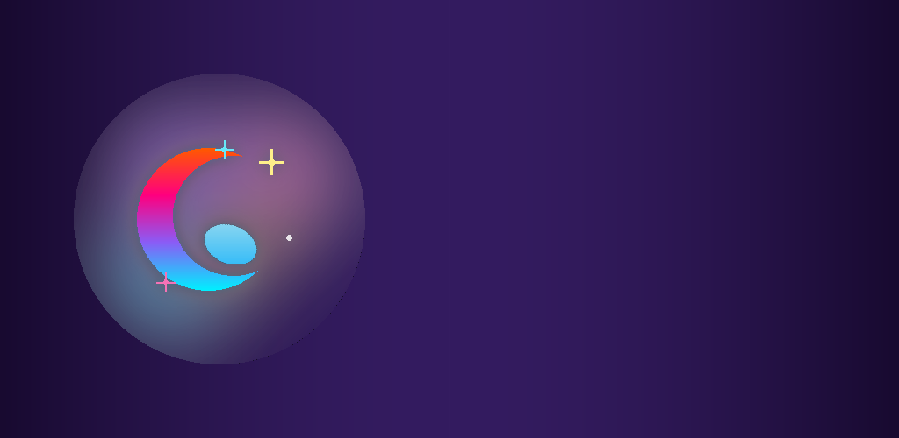

  <h1>Luna Music</h1>  
A FOSS YouTube Music client for Android and Desktop with many features from Spotify, SponsorBlock, ReturnYouTubeDislike using Compose Multiplatform to develop.
  
 
 
 
 

  <b>Developed by <a href="https://github.com/PB2204">Pabitra Banerjee</a></b> 
  <a href="https://github.com/PB2204/Luna">GitHub</a> • 
  <a href="https://www.linkedin.com/in/pabitra-banerjee">LinkedIn</a> • 
  <a href="https://www.facebook.com/Comrade.Pabitra.Banerjee">Facebook</a> • 
  <a href="https://luna-music-app.web.app">Official Website</a>

  
<h4>Download</h4>  
 
 
 
 On vivo phones, install <code>Luna-full-vivo-*.apk</code> from <a href="https://github.com/PB2204/Luna/releases">Releases</a> for Origin Island and the music widget.
<h4>Nightly Build & Releases</h4>  
 

  

> **Luna Music** is available on Android, Windows, macOS, and Linux!
> Clean Architecture, Compose Multiplatform, 100% Free & Open Source.

  
## Features ✨️    
- Play music from YouTube Music or YouTube for free, without ads and in the background
- Recognize the song playing near you, then find it in Luna Music (Android)
- Add your own synced lyrics, line by line or word by word, to songs that have none
- Read YouTube comments in Now Playing, and post, reply or like them when signed in
- Your library sidebar on Desktop with your playlists, albums, artists and podcasts
- Three Now Playing styles: Classic, Material 3 Expressive and a redesigned Apple Music player with Apple Music-style lyrics
- Ten-band equalizer with presets and AutoEq headphone profiles, plus Delay and Reverb effects, or your phone's system equalizer on Android
- Pick the speaker, headphones or Cast device Luna Music plays on, without moving other apps' audio
- Luna Wrapped: your year in music, plus monthly recap playlists
- On-device listening analytics: charts, period history, listening clock and a shareable listening receipt
- Word-by-word Apple Music-style lyrics, romanization for 12 languages, share lyrics as an image, landscape fullscreen lyrics and a timing offset
- Home screen widgets: turntable, playlists and listening insights
- Send your sign-ins from Android to Desktop by scanning a QR code
- Preferred audio language for videos with several audio tracks
- High quality up-to 256kbps stream (Opus or AAC) for YouTube Music Premium users
- Browsing Home, Charts, Podcast, Moods & Genre with YouTube Music data at high speed    
- Search everything on YouTube    
- Spotify Canvas and Animated Album Art supported
- Play 1080p video option with subtitle    
- Play YouTube Music live stations
- AI song suggestions and an AI reading of your music taste
- Import playlists converted from Spotify and other apps
- Customize your playlist, synced with YouTube Music
- Notifications from followed artists    
- Caching and offline playback support, plus Smart downloads of the songs you play most (Android)    
- Crossfade with DJ-style like Apple Music
- Customizing THEME (Light, Dark, Color, etc)
- Synced lyrics from Luna Lyrics, LRCLIB, BetterLyrics, Spotify (require login) and YouTube Transcript - AI lyrics translation (BETA) (\*)  
- Personalize data (\**) and multi-YouTube-account support    
- Dislike songs on YouTube Music so it recommends them less
- Last.fm scrobbling (Full version)
- Supports SponsorBlock and Return YouTube Dislike
- Sleep Timer    
- Android Auto with online content, feature rich UI/UX
- Discord Rich Presence support
- Listen Together: shared rooms that play in sync with friends
- And many more!    
  
> (\*) Use your OpenAI or Gemini API key    
> (\**) For users who chose "Send back to Google" feature    
    
> **Warning**    
> This app is in active development. If you find any bugs, please create an issue on GitHub.
    
## Screenshots    
 
          
           
           
           
  

 ## Data    
- This app uses hidden API from YouTube Music with smart optimizations to stream audio directly.    
- Uses Spotify Web API for Canvas artwork and synchronised lyrics.    
- SponsorBlock integration to automatically skip sponsorships, intros, and non-music segments.    
- Return YouTube Dislike support.
- Synced lyrics integration from Luna Lyrics and LRCLIB.
- Song recognition powered by Shazam algorithms.
 
 ## Privacy    
 Luna Music does not contain any trackers or third-party analytical surveillance. If YouTube logged-in users enable the optional "Send back to Google" feature, Luna Music directly interacts with standard YouTube Music endpoints to keep your listening history synced with your Google account.

## Desktop App

### Which file should I download?
- **Windows**: Download `Luna-Windows-installer.zip`, extract and run `install.bat` (or `.msix` / `.exe`).
- **macOS**: Download `.dmg` (macOS 12 or newer, Intel & Apple Silicon supported).
- **Linux**: Download `.AppImage` (runs on all major distributions).

 ## FAQ    
 #### 1. What is Luna Music?
 Luna Music ("Luna" in short) is a modern, privacy-focused open source music client built with Compose Multiplatform, designed to provide a premium music streaming experience across Android and Desktop.
 
 #### 2. How are lyrics synced?
 Lyrics are sourced through Luna Lyrics and LRCLIB with precise line-by-line and word-by-word timing. Users can also submit and adjust lyric offsets directly in the player.

## Contributing

Contributions are welcome! Please follow these steps:
1. Open an issue on [GitHub Issues](https://github.com/PB2204/Luna/issues) describing your feature or bug fix.
2. Fork the repository and create your feature branch: `git checkout -b feature/my-feature`.
3. Commit your changes and open a Pull Request.

## Legal Disclaimer & Terms of Use

### 1. 100% Free, Open-Source & Strictly Non-Commercial
Luna Music is a fully open-source project (FOSS) created purely for educational purposes and personal use. **We do not sell this application, nor do we monetize it in any way.** There are no advertisements, no premium features, no subscriptions, and no hidden fees within the app. This project has absolutely no commercial value or financial intent. 

### 2. A Custom Browser with Content Filtering
Luna Music acts strictly as a specialized, third-party web browser and client. It simply parses the publicly available website content and APIs of YouTube and YouTube Music, rendering them in a custom user interface. The ad-free experience it provides is fundamentally no different from using a standard web browser (like Chrome, Firefox, or Brave) equipped with a common ad-blocking extension (such as uBlock Origin). 

### 3. Support Content Creators
We deeply respect the hard work of artists, musicians, and content creators. **We strongly encourage all users to subscribe to [YouTube Premium](https://www.youtube.com/premium).** Purchasing a Premium subscription is the best way to financially support the creators you listen to and ensure the continued growth of the platform. Luna Music is built as a proof-of-concept for developers and enthusiasts, not to harm creators' revenues.

### 4. No Hosting of Copyrighted Material
We do not host, upload, distribute, or store any audio, video, or copyrighted media files on our own servers. All content accessed through this application is stored entirely on Google's/YouTube's servers and remains the property of their respective copyright owners. The app merely acts as a conduit to stream publicly accessible links.

### 5. User Responsibility & Legal Contact
The software is provided "AS IS", without warranty of any kind. The developers of Luna Music do not encourage or condone piracy. Users are solely responsible for ensuring their usage of this app complies with their local copyright laws and the Terms of Service of the platforms they access. 

## Developer Profile & Contact

- **Developer**: Pabitra Banerjee
- **GitHub**: [https://github.com/PB2204/Luna](https://github.com/PB2204/Luna)
- **LinkedIn**: [https://www.linkedin.com/in/pabitra-banerjee](https://www.linkedin.com/in/pabitra-banerjee)
- **Facebook**: [https://www.facebook.com/Comrade.Pabitra.Banerjee](https://www.facebook.com/Comrade.Pabitra.Banerjee)
- **Website**: [https://luna-music-app.web.app](https://luna-music-app.web.app)

---

  Made with ❤️ by <a href="https://github.com/PB2204">Pabitra Banerjee</a>

